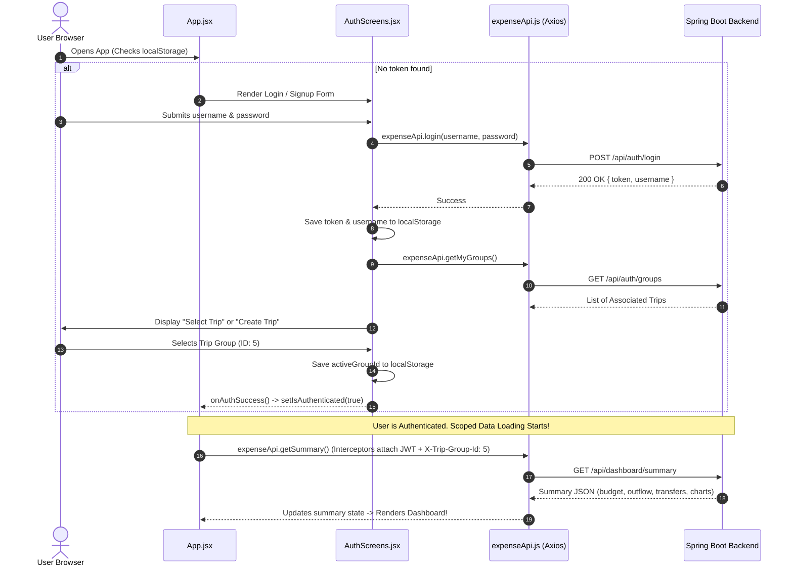

# 🎨 Frontend Code & Workflow Comprehensive Guide (`Readme_Code_Explanation`)

> **Target Audience:** Beginners with **zero prior knowledge** of React, JavaScript, Vite, CSS, or single-page web applications.  
> **Goal:** This document explains the **exact workflow**, **component hierarchy**, and **every single line of code, hook, styling token, and configuration** in the Trip Expense Tracker frontend repository without skipping anything.

---

## 📑 Table of Contents
1. [Fundamental Concepts for Beginners](#1-fundamental-concepts-for-beginners)
   - [What is a Frontend / Single Page Application (SPA)?](#what-is-a-frontend--single-page-application-spa)
   - [What is React? (Components, JSX & Virtual DOM)](#what-is-react-components-jsx--virtual-dom)
   - [What are React Hooks? (`useState`, `useEffect`, `useCallback`, `useRef`)](#what-are-react-hooks)
   - [What is Vite?](#what-is-vite)
   - [What is Tailwind CSS & Glassmorphism?](#what-is-tailwind-css--glassmorphism)
   - [What is Framer Motion?](#what-is-framer-motion)
   - [What is Axios & Request Interceptors?](#what-is-axios--request-interceptors)
   - [What is Browser LocalStorage?](#what-is-browser-localstorage)
2. [Frontend Architecture & Visual Workflow](#2-frontend-architecture--visual-workflow)
   - [Component Hierarchy Tree](#component-hierarchy-tree)
   - [State Management & Authentication Lifecycle](#state-management--authentication-lifecycle)
   - [Multi-Tenancy Scoping via `X-Trip-Group-Id`](#multi-tenancy-scoping-via-x-trip-group-id)
   - [Interactive Feature Matrix](#interactive-feature-matrix)
3. [Configuration & Build Files Line-by-Line](#3-configuration--build-files-line-by-line)
   - [`package.json` (Dependencies & Scripts)](#packagejson-line-by-line)
   - [`vite.config.js` (Dev Server & Proxy)](#viteconfigjs-line-by-line)
   - [`tailwind.config.js` (Color Palette & Custom Theme)](#tailwindconfigjs-line-by-line)
   - [`postcss.config.js` & `index.html`](#postcssconfigjs--indexhtml-line-by-line)
   - [`src/index.css` (Glassmorphism & Button Design Tokens)](#srcindexcss-line-by-line)
4. [Application Bootstrap & API Engine](#4-application-bootstrap--api-engine)
   - [`src/main.jsx`](#srcmainjsx-line-by-line)
   - [`src/api/expenseApi.js` (Axios Client & Endpoints)](#srcapiexpenseapijs-line-by-line)
   - [`src/App.jsx` (Core App State Orchestrator)](#srcappjsx-line-by-line)
5. [Components Explained Line-by-Line](#5-components-explained-line-by-line)
   - [`components/AuthScreens.jsx` (Authentication & Trip Selection)](#authscreensjsx-line-by-line)
   - [`components/Header.jsx` (Top Navigation & Profile Banner)](#headerjsx-line-by-line)
   - [`components/SummaryCards.jsx` (Top Metric Cards & Budget Progress)](#summarycardsjsx-line-by-line)
   - [`components/QuickWaterButton.jsx` (1-Tap Express Purchases & Confetti)](#quickwaterbuttonjsx-line-by-line)
   - [`components/AnalyticsCharts.jsx` (Recharts Donut & Daily Outflow)](#analyticschartsjsx-line-by-line)
   - [`components/ExpenseList.jsx` (Transactions Table, Search & Filters)](#expenselistjsx-line-by-line)
   - [`components/ExpenseModal.jsx` (Add & Edit Purchase Modal)](#expensemodaljsx-line-by-line)
   - [`components/FundModal.jsx` (Cash Pool Deposit Modal)](#fundmodaljsx-line-by-line)
   - [`components/FundHistoryModal.jsx` (Cash & Online Deposit Ledger)](#fundhistorymodaljsx-line-by-line)
   - [`components/PreTripPlanner.jsx` (Budgets, Advance Bookings & Split Outflows)](#pretripplannerjsx-line-by-line)
   - [`components/CalculatorWidget.jsx` (Floating On-Spot Calculator)](#calculatorwidgetjsx-line-by-line)
   - [`components/CustomDatePicker.jsx` (Glassmorphic Calendar Picker)](#customdatepickerjsx-line-by-line)
   - [`components/WarningDialog.jsx` (Accessible Confirm & Alert Hook)](#warningdialogjsx-line-by-line)
6. [Quick React & Tailwind Reference Dictionary](#6-quick-react--tailwind-reference-dictionary)

---

## 1. Fundamental Concepts for Beginners

If you have never written frontend code before, read this section first. Every file in this project uses these core web technologies:

### What is a Frontend / Single Page Application (SPA)?
In traditional websites from 15 years ago, clicking a button caused the entire browser screen to reload and fetch a new HTML page from the server.  
A **Single Page Application (SPA)** loads a single HTML page once. When you click buttons, switch tabs, or add expenses:
- JavaScript intercepts your actions in real time.
- Only the specific part of the screen that changed is re-rendered instantly.
- The web page feels as smooth, responsive, and tactile as a native mobile app!

### What is React? (Components, JSX & Virtual DOM)
- **React** is the world's most popular JavaScript library for building user interfaces, developed by Meta.
- **Components**: Instead of writing one giant 5,000-line HTML file, React lets you split the screen into independent, reusable lego bricks called **Components** (e.g. `<Header />`, `<SummaryCards />`, `<ExpenseModal />`).
- **JSX (JavaScript XML)**: A syntax extension allowing you to write HTML-like markup directly inside JavaScript files (`.jsx`).
- **Virtual DOM**: React keeps an in-memory representation of the user interface. When data updates, React calculates the minimum difference (the "diff") and updates only those specific pixels on the screen.

### What are React Hooks?
Hooks are special functions provided by React that let your components remember data and execute code at specific points in their lifecycle:
1. **`useState(initialValue)`**: Remembers a variable inside a component. When the state changes (via `setState`), React automatically re-renders the component to show the new value on the screen.
2. **`useEffect(callback, [dependencies])`**: Runs code when the component first appears on the screen (mounts) or whenever any value in the dependency array changes (e.g. fetching expenses from the backend whenever the selected date changes).
3. **`useCallback(fn, [dependencies])`**: Caches a function definition between renders so it is not unnecessarily recreated on every millisecond.
4. **`useRef(initialValue)`**: Holds a reference to a DOM element directly (e.g. detecting if a user clicked outside a dropdown menu) without triggering a re-render.

### What is Vite?
**Vite** (French word for "fast", pronounced `/veet/`) is the next-generation frontend build tool created by Evan You. It replaces older tools like Webpack by:
- Starting local development servers in less than 300 milliseconds.
- Using native ES Modules for instantaneous Hot Module Replacement (HMR)—when you edit code in your editor, your browser updates in real time without refreshing!

### What is Tailwind CSS & Glassmorphism?
- **Tailwind CSS**: A utility-first CSS framework. Instead of writing separate `.css` files with custom class names, you style elements directly in your JSX using atomic utility classes (e.g. `p-4` for padding, `rounded-2xl` for rounded corners, `text-cyan-400` for cyan text).
- **Glassmorphism**: A modern aesthetic trend used throughout this app featuring translucent dark cards (`bg-slate-900/60`), subtle borders (`border-white/10`), frosted-glass background blur (`backdrop-blur-xl`), and neon color glows (`shadow-glow-cyan`).

### What is Framer Motion?
A production-ready animation library for React. By replacing standard HTML tags like `<div>` with `<motion.div>`, we can declare entrance animations (`initial={{ opacity: 0, y: 20 }}`), spring transitions, and exit animations using `<AnimatePresence>`.

### What is Axios & Request Interceptors?
- **Axios** is a promise-based HTTP client for the browser.
- **Interceptors**: Functions that automatically intercept every single HTTP request before it leaves your browser. In this project, an Axios interceptor attaches your **JWT authentication token** and your **`X-Trip-Group-Id`** to every API call automatically!

### What is Browser LocalStorage?
A small, built-in key-value storage engine inside your browser that persists even when you close the tab or reboot your laptop. This project stores:
- `token`: The cryptographically signed JWT login token.
- `username`: The username of the logged-in user.
- `activeGroupId`: The ID of the currently selected trip group.

---

## 2. Frontend Architecture & Visual Workflow

### Component Hierarchy Tree
```
[ index.html ]
      │
[ main.jsx ] (Mounts React into DOM)
      │
  [ App.jsx ] (Global State Orchestrator)
      │
      ├── <AuthScreens /> (Shown if !isAuthenticated)
      │      ├── Login Screen
      │      ├── Signup Screen
      │      ├── Group Setup Screen (with Live Member Account Verification)
      │      └── Group Selection Screen (Admin Trips vs Shared Member Trips)
      │
      ├── <Header /> (Trip title, user role badge, logout, modal openers)
      │
      ├── <SummaryCards /> (Budget, Spent, Remaining Balance, Cost Share)
      │
      ├── <QuickWaterButton /> (1-Tap Express Purchases with Confetti)
      │
      ├── <AnalyticsCharts /> (Recharts Donut & Outflow Timeline)
      │
      ├── Settlements & Member Budgets Grid (Who owes whom + Debt Settling)
      │
      ├── <ExpenseList /> (Transactions table, Search, Filters, Date Picker)
      │
      ├── <PreTripPlanner /> (Sub-view: Members, Budgets, Advance Bookings)
      │
      ├── Modals:
      │      ├── <ExpenseModal /> (Create / Edit Live Expense)
      │      ├── <FundModal /> (Deposit to Communal Cash Pool)
      │      ├── <FundHistoryModal /> (Cash Pool Ledger & Payment Mode Toggling)
      │      └── Debt Settlement Modal (Peer-to-Peer Settle Confirmation)
      │
      ├── <CalculatorWidget /> (Floating Draggable On-Spot Calculator)
      │
      └── <WarningDialog /> (Accessible confirmation & alert dialogs)
```

### State Management & Authentication Lifecycle


### Multi-Tenancy Scoping via `X-Trip-Group-Id`
Every single query made by the frontend passes the active group ID to the backend via the `X-Trip-Group-Id` header.  
This guarantees:
1. When you add a new purchase, it is saved under the active trip.
2. When you switch between different trips using the "Switch Trip" button, the active group ID updates in `localStorage`, and the entire dashboard re-fetches data specifically for that trip.
3. If you are viewing a trip as an invited member (not creator), `summary.isReadOnly` becomes `true`, causing action buttons to automatically hide and displaying a prominent **Read-Only Mode** warning banner.

### Interactive Feature Matrix
- **1-Tap Express Purchases**: Log water bottles (₹20), snacks (₹50), or rides (₹100) instantly with animated particle confetti.
- **On-Spot Floating Calculator**: Draggable calculator with keyboard support so you can split restaurant tips and tax without leaving the app.
- **Dark Glassmorphic Date Picker**: Zero-dependency custom calendar dropdown with keyboard month navigation.
- **Dynamic Link Rendering**: Any URLs pasted into expense notes (e.g., Google Drive receipts, Airbnb reservation links) automatically render as clickable, styled hyperlinks.

---

## 3. Configuration & Build Files Line-by-Line

### `package.json` Line-by-Line
File: `Frontend/package.json`

```json
1: {
2:   "name": "trip-expense-tracker-frontend",
3:   "private": true,
4:   "version": "0.0.0",
5:   "type": "module",
```
- Line 2: The project package name.
- Line 3: `private: true`: Prevents accidental publication to the public npm registry.
- Line 5: `"type": "module"`: Instructs Node.js to use modern ECMAScript standard modules (`import` / `export` syntax instead of `require`).

```json
6:   "scripts": {
7:     "dev": "vite",
8:     "build": "vite build",
9:     "lint": "eslint . --ext js,jsx --report-unused-disable-directives --max-warnings 0",
10:    "preview": "vite preview"
11:  },
```
- Line 7: `npm run dev`: Starts the ultra-fast Vite development server.
- Line 8: `npm run build`: Bundles and minifies the application into optimized static HTML, CSS, and JS files in the `dist/` directory.
- Line 10: `npm run preview`: Locally serves the production `dist/` build to preview before cloud deployment.

```json
12:  "dependencies": {
13:    "axios": "^1.6.8",
14:    "canvas-confetti": "^1.9.3",
15:    "clsx": "^2.1.1",
16:    "framer-motion": "^11.1.9",
17:    "lucide-react": "^0.378.0",
18:    "react": "^18.3.1",
19:    "react-dom": "^18.3.1",
20:    "recharts": "^2.12.7",
21:    "tailwind-merge": "^2.3.0"
22:  },
```
- Line 13: `axios`: Modern HTTP client for sending API requests with request interceptors.
- Line 14: `canvas-confetti`: High-performance HTML5 canvas confetti animation library.
- Line 15 & 21: `clsx` and `tailwind-merge`: Utilities for conditionally combining and merging Tailwind CSS classes without style conflicts.
- Line 16: `framer-motion`: Motion and physics-based animation engine for React.
- Line 17: `lucide-react`: Modern, consistent SVG icon set (hundreds of icons like `Calendar`, `Trash2`, `Users`).
- Line 18–19: `react` and `react-dom` version 18.3.1: The core React UI engine and DOM renderer.
- Line 20: `recharts`: Declarative React charting library built on SVG.

```json
23:  "devDependencies": {
24:    "@types/react": "^18.3.1",
25:    "@types/react-dom": "^18.3.0",
26:    "@vitejs/plugin-react": "^4.2.1",
27:    "autoprefixer": "^10.4.19",
28:    "postcss": "^8.4.38",
29:    "tailwindcss": "^3.4.3",
30:    "vite": "^5.2.11"
31:  }
```
- Developer tools: React plugin for Vite, PostCSS compiler, Autoprefixer (adds vendor CSS prefixes like `-webkit-` automatically), and Tailwind CSS compiler.

---

### `vite.config.js` Line-by-Line
File: `Frontend/vite.config.js`

```javascript
1: import { defineConfig } from 'vite'
2: import react from '@vitejs/plugin-react'
3: 
4: export default defineConfig({
5:   plugins: [react()],
```
- Line 5: Enables the official Vite React plugin with Fast Refresh support.

```javascript
7:   server: {
8:     port: 3000,
9:     proxy: {
10:       '/api': {
11:         target: 'http://localhost:8080',
12:         changeOrigin: true,
13:       }
14:     }
15:   }
16: })
```
- Line 8: Sets the local development server port to `3000`.
- Lines 9–14: Configures a local proxy: any request sent to `/api/*` on port 3000 is automatically proxied to the Spring Boot backend on `http://localhost:8080`, completely preventing local CORS issues during development!

---

### `tailwind.config.js` Line-by-Line
File: `Frontend/tailwind.config.js`

Configures the custom dark glassmorphic design theme.

```javascript
3:   content: [
4:     "./index.html",
5:     "./src/**/*.{js,ts,jsx,tsx}",
6:   ],
```
- Lines 3–6: Tells Tailwind which files to scan so it can purge unused CSS classes from the final bundle.

```javascript
9:       colors: {
10:        dark: {
11:          bg: "#0B0F19",
12:          card: "#151C2C",
13:          border: "#232E47",
14:        },
15:        brand: {
16:          cyan: "#00F2FE",
17:          blue: "#4FACFE",
18:          emerald: "#10B981",
19:          violet: "#8B5CF6",
20:          rose: "#F43F5E",
21:          amber: "#F59E0B",
22:        }
23:      },
```
- Lines 9–23: Defines curated HSL hex color tokens:
  - Deep dark background (`#0B0F19`), translucent card surface (`#151C2C`), and borders (`#232E47`).
  - Vivid accent tokens for neon badges, charts, and buttons.

```javascript
27:      boxShadow: {
28:        'glow-cyan': '0 0 25px -5px rgba(0, 242, 254, 0.3)',
29:        'glow-emerald': '0 0 25px -5px rgba(16, 185, 129, 0.3)',
30:        'glow-violet': '0 0 25px -5px rgba(139, 92, 246, 0.3)',
31:        'glow-rose': '0 0 25px -5px rgba(244, 63, 94, 0.3)',
32:      },
```
- Lines 27–32: Custom neon glow drop-shadow filters used on buttons and alert cards.

```javascript
33:      animation: {
34:        'pulse-slow': 'pulse 4s cubic-bezier(0.4, 0, 0.6, 1) infinite',
35:        'float': 'float 3s ease-in-out infinite',
36:      },
```
- Lines 33–42: Custom CSS keyframes for floating elements and pulsing neon badges.

---

### `postcss.config.js` & `index.html` Line-by-Line
- **`postcss.config.js`**: Registers `tailwindcss` and `autoprefixer` plugins in the PostCSS pipeline.
- **`index.html`**:
  - Sets `<html class="dark">` to enable dark mode globally.
  - Links the **Google Inter font** family (weights 300 to 800) for typography.
  - Uses an inline SVG airplane icon (`data:image/svg+xml,...✈️`) as the browser favicon.
  - Declares `<div id="root"></div>`, where the React application mounts.

---

### `src/index.css` Line-by-Line
File: `Frontend/src/index.css`

Contains core global style rules and utility classes:

```css
1: @tailwind base;
2: @tailwind components;
3: @tailwind utilities;
```
- Injects Tailwind's base reset styles, component classes, and utility rules.

```css
6:   .glass-card {
7:     background: rgba(21, 28, 44, 0.65);
8:     backdrop-filter: blur(16px);
9:     -webkit-backdrop-filter: blur(16px);
10:    border: 1px solid rgba(255, 255, 255, 0.08);
11:  }
```
- Lines 6–11: The foundation of the app's visual identity. Applies 65% opacity dark slate background with a 16px frosted-glass Gaussian blur and a subtle 8% white border.

```css
13:  .glass-card-hover {
14:    transition: all 0.3s cubic-bezier(0.4, 0, 0.2, 1);
15:  }
16:  .glass-card-hover:hover {
17:    background: rgba(30, 41, 64, 0.8);
18:    border-color: rgba(0, 242, 254, 0.3);
19:    box-shadow: 0 10px 30px -10px rgba(0, 242, 254, 0.15);
20:    transform: translateY(-2px);
21:  }
```
- Lines 13–21: Micro-interaction: cards elevate by 2 pixels with a cyan glow when hovered.

```css
23:  .glass-input {
24:    background: rgba(15, 23, 42, 0.6);
25:    border: 1px solid rgba(255, 255, 255, 0.12);
26:    backdrop-filter: blur(8px);
27:    color: #F8FAFC;
28:    color-scheme: dark;
29:  }
30:  .glass-input:focus {
31:    outline: none;
32:    border-color: #00F2FE;
33:    box-shadow: 0 0 15px rgba(0, 242, 254, 0.25);
34:  }
```
- Lines 23–34: Input fields with dark color scheme and an animated cyan focus glow ring.

```css
52:  .btn-premium {
53:    position: relative;
54:    display: inline-flex;
55:    align-items: center;
56:    justify-content: center;
57:    gap: 0.5rem;
58:    font-weight: 700;
59:    transition: all 0.25s cubic-bezier(0.4, 0, 0.2, 1);
60:    cursor: pointer;
61:    overflow: hidden;
62:    user-select: none;
63:  }
64:  .btn-premium:hover {
65:    transform: translateY(-1.5px) scale(1.025);
66:  }
67:  .btn-premium:active {
68:    transform: translateY(1px) scale(0.965);
69:    transition: all 0.05s ease;
70:  }
```
- Lines 52–70: Tactile button physics: hover scales up slightly (`1.025`), while click press depresses realistically (`0.965`).

```css
72:  .btn-cyan {
73:    background: linear-gradient(135deg, #00F2FE 0%, #4FACFE 100%);
74:    color: #0F172A;
75:    box-shadow: 0 4px 15px rgba(0, 242, 254, 0.25);
76:  }
```
- Vibrant gradient button tokens for `.btn-cyan`, `.btn-violet`, `.btn-secondary`, and `.btn-danger`.

```css
143: ::-webkit-scrollbar {
144:   width: 6px;
145:   height: 6px;
146: }
...
154: ::-webkit-scrollbar-thumb:hover {
155:   background: rgba(0, 242, 254, 0.4);
156: }
```
- Lines 143–156: Custom ultra-thin dark scrollbars with cyan hover highlights.

---

## 4. Application Bootstrap & API Engine

### `src/main.jsx` Line-by-Line
File: `Frontend/src/main.jsx`

```javascript
1: import React from 'react'
2: import ReactDOM from 'react-dom/client'
3: import App from './App.jsx'
4: import './index.css'
5: 
6: ReactDOM.createRoot(document.getElementById('root')).render(
7:   <React.StrictMode>
8:     <App />
9:   </React.StrictMode>,
10: )
```
- Line 6: Locates `<div id="root">` in `index.html` and creates the React 18 Concurrent Mode root.
- Line 7: `<React.StrictMode>`: Development helper that highlights potential side-effects and verifies component purity by intentionally double-invoking lifecycle methods in local dev mode.
- Line 8: Mounts the root component `<App />`.

---

### `src/api/expenseApi.js` Line-by-Line
File: `Frontend/src/api/expenseApi.js`

Centralized network communication engine. All HTTP requests flow through this file.

```javascript
3: const getBaseUrl = () => {
4:   if (typeof window !== 'undefined') {
5:     const hostname = window.location.hostname;
6:     if (hostname === 'localhost' || hostname === '127.0.0.1') {
7:       return 'http://localhost:8080/api';
8:     }
9:   }
10:   return import.meta.env.VITE_API_URL || 'https://tour-expence-tracker-backend.onrender.com/api';
11: };
```
- Lines 3–11: **Smart Dynamic Base URL Resolution**:
  - If running in a local browser on `localhost` or `127.0.0.1`, routes to `http://localhost:8080/api`.
  - If deployed to production (like Vercel), automatically points to the production cloud backend (`https://tour-expence-tracker-backend.onrender.com/api`) or uses `VITE_API_URL` if configured.

```javascript
13: const api = axios.create({
14:   baseURL: getBaseUrl(),
15:   headers: {
16:     'Content-Type': 'application/json',
17:   },
18: });
```
- Lines 13–18: Instantiates the Axios client with default JSON headers.

```javascript
20: // Request interceptor to attach JWT token to all requests
21: api.interceptors.request.use(
22:   (config) => {
23:     const token = localStorage.getItem('token');
24:     if (token) {
25:       config.headers['Authorization'] = `Bearer ${token}`;
26:     }
27:     const activeGroupId = localStorage.getItem('activeGroupId');
28:     if (activeGroupId) {
29:       config.headers['X-Trip-Group-Id'] = activeGroupId;
30:     }
31:     return config;
32:   },
33:   (error) => {
34:     return Promise.reject(error);
35:   }
36: );
```
- Lines 21–36: **Global Request Interceptor**:
  - Automatically retrieves `token` from `localStorage` and injects `Authorization: Bearer <token>`.
  - Automatically retrieves `activeGroupId` and injects `X-Trip-Group-Id: <id>`.
  - Result: No individual component needs to manually look up tokens or headers before calling API methods!

```javascript
38: export const expenseApi = {
40:   login: async (username, password) => {
41:     const response = await api.post('/auth/login', { username, password });
42:     return response.data;
43:   },
...
50:   checkMemberExists: async (identifier) => {
51:     const response = await api.get('/auth/member-exists', { params: { identifier } });
52:     return response.data.exists;
53:   },
...
55:   createGroup: async (groupName, memberUsernames) => { ... },
60:   getMyGroups: async () => { ... },
65:   deleteGroup: async (id) => { ... },
70:   getSummary: async () => { ... },
76:   getAllExpenses: async () => { ... },
81:   getExpensesByDate: async (dateString) => { ... },
86:   getExpensesByCategory: async (category) => { ... },
91:   createExpense: async (expenseData) => { ... },
96:   updateExpense: async (id, expenseData) => { ... },
101:  deleteExpense: async (id) => { ... },
121:  getPreTripMembers: async () => { ... },
126:  savePreTripMember: async (memberData) => { ... },
135:  getPreTripExpenses: async () => { ... },
140:  createPreTripExpense: async (expenseData) => { ... },
154:  getPreTripSummary: async () => { ... },
158: };
```
- Lines 38–158: Clean, async wrapper methods mapping directly to the backend REST endpoints.

---

### `src/App.jsx` Line-by-Line
File: `Frontend/src/App.jsx`

The central state manager and orchestrator of the entire application.

```javascript
18: export default function App() {
19:   const [isAuthenticated, setIsAuthenticated] = useState(
20:     !!localStorage.getItem('token') && !!localStorage.getItem('activeGroupId')
21:   );
```
- Lines 19–21: Determines authentication state on initial page load: true only if **both** a JWT token and an active trip group ID exist in browser storage.

```javascript
22:   const [summary, setSummary] = useState(null);
23:   const [expenses, setExpenses] = useState([]);
24:   const [funds, setFunds] = useState([]);
25:   const [selectedDate, setSelectedDate] = useState('');
26:   const [selectedCategory, setSelectedCategory] = useState('ALL');
28:   const [isExpenseModalOpen, setIsExpenseModalOpen] = useState(false);
29:   const [expenseToEdit, setExpenseToEdit] = useState(null);
33:   const [settlingTransfer, setSettlingTransfer] = useState(null);
36:   const [currentView, setCurrentView] = useState('dashboard');
37:   const [loading, setLoading] = useState(true);
```
- Lines 22–37: Defines all reactive state variables:
  - `summary`: Holds consolidated totals, remaining balance, category charts, and settlement transfers.
  - `expenses`: Array of active trip expense records.
  - `selectedDate` & `selectedCategory`: Filter criteria.
  - `currentView`: Toggles between `'dashboard'` and `'pretrip'`.

```javascript
45:   const loadData = useCallback(async () => {
46:     if (!isAuthenticated) return;
47:     try {
48:       setLoading(true);
49:       const summaryData = await expenseApi.getSummary();
50:       setSummary(summaryData);
52:       const fundsData = await expenseApi.getAllFunds();
53:       setFunds(fundsData);
55:       let expenseData = [];
56:       if (selectedDate) {
57:         expenseData = await expenseApi.getExpensesByDate(selectedDate);
58:       } else if (selectedCategory !== 'ALL') {
59:         expenseData = await expenseApi.getExpensesByCategory(selectedCategory);
60:       } else {
61:         expenseData = await expenseApi.getAllExpenses();
62:       }
64:       setExpenses(expenseData);
65:     } catch (err) {
66:       console.error('Failed to load data from backend:', err);
67:     } finally {
68:       setLoading(false);
69:     }
70:   }, [selectedDate, selectedCategory, isAuthenticated]);
```
- Lines 45–70: `loadData`: Core data synchronization function wrapped in `useCallback`. Fetches summary metrics, cash funds, and expenses (filtered by date, category, or unfiltered).

```javascript
72:   useEffect(() => {
73:     if (isAuthenticated) {
74:       loadData();
75:     }
76:   }, [loadData, isAuthenticated]);
```
- Lines 72–76: Re-executes `loadData` whenever the user logs in or filter criteria change.

```javascript
78:   const handleLogout = () => {
79:     localStorage.removeItem('token');
80:     localStorage.removeItem('username');
81:     localStorage.removeItem('activeGroupId');
82:     setIsAuthenticated(false);
83:     setSummary(null);
84:     setExpenses([]);
85:   };
```
- Lines 78–85: Completely purges credentials from storage and resets state back to the login screen.

```javascript
87:   const handleSwitchTrip = () => {
88:     localStorage.removeItem('activeGroupId');
89:     setIsAuthenticated(false);
...
92:   };
```
- Lines 87–92: Clears only the active group ID so the user can pick another trip from the trip selector without re-entering their password.

```javascript
94:   if (!isAuthenticated) {
95:     return (
96:       <AuthScreens
97:         onAuthSuccess={(data) => {
98:           setIsAuthenticated(true);
99:         }}
100:      />
101:    );
102:  }
```
- Lines 94–102: Conditional view guard: If not authenticated, renders `<AuthScreens />`.

```javascript
127:  const handleConfirmSettle = async (amountToSettle) => { ... }
```
- Lines 127–147: **Debt Settlement Handler**:  
  When user clicks "Settle" on a peer-to-peer balance transfer (e.g. Rahul owes Kamal ₹500):
  1. Validates the positive number.
  2. Sends an expense with `category: 'SETTLEMENT'` and notes: `'Settle:Rahul:Kamal'`.
  3. Reloads data, which triggers the backend's greedy algorithm to recalculate new remaining balances!

---

## 5. Components Explained Line-by-Line

### `AuthScreens.jsx` Line-by-Line
File: `Frontend/src/components/AuthScreens.jsx`

Manages user authentication and trip selection across four distinct screens:
1. `'login'`: Username and password authentication with eye icon to toggle password visibility.
2. `'signup'`: New account registration (username, email, password).
3. `'setupGroup'`: Creating a new trip with live invited member verification.
4. `'selectGroup'`: Selecting from existing trips (separated into **Admin Trips** vs **Shared Trips**).

```javascript
50:   useEffect(() => {
51:     if (screen !== 'setupGroup') return undefined;
56:     const identifiers = [...new Set(members.map(m => m.trim()).filter(id => id && id.toLowerCase() !== currentUsername))];
59:     const timeoutId = window.setTimeout(() => {
...
70:       identifiers.forEach(async (identifier) => {
71:         const exists = await expenseApi.checkMemberExists(identifier);
...
75:       });
86:     }, 350);
88:     return () => window.clearTimeout(timeoutId);
89:   }, [currentUsername, members, screen]);
```
- Lines 50–93: **Debounced Real-Time Account Verification**:
  - While typing member names into the trip invite form, waits 350ms of typing inactivity.
  - Calls `expenseApi.checkMemberExists(name)`.
  - If found: renders green badge *"Account found. Ready to invite."*
  - If missing: renders red badge *"No account found. Ask them to create an account first."*

```javascript
224:  const handleDeleteGroup = async (groupId, e) => {
225:    e.stopPropagation();
226:    if (await confirm('Are you sure you want to permanently delete this trip group?...')) {
232:      await expenseApi.deleteGroup(groupId);
233:      const groups = await expenseApi.getMyGroups();
234:      setAvailableGroups(groups);
...
237:    }
238:  };
```
- Lines 224–244: Allows group creators (admins) to delete an entire trip group with a single click, showing a modal confirmation. Uses `e.stopPropagation()` so clicking delete does not accidentally trigger opening the dashboard.

---

### `Header.jsx` Line-by-Line
File: `Frontend/src/components/Header.jsx`

```javascript
22:   <div className="flex justify-between items-center mb-6 pb-4 border-b border-white/5 relative z-10">
23:     <div className="flex items-center gap-2 text-xs text-slate-400 font-semibold">
24:       <User className="w-3.5 h-3.5 text-cyan-400" />
25:       <span>Logged in as: <strong className="text-white">{username}</strong></span>
27:       <span className={`px-2 py-0.5 rounded-full text-[10px] ${isReadOnly ? 'bg-amber-500/10 text-amber-300' : 'bg-emerald-500/10 text-emerald-300'}`}>
28:         {isReadOnly ? 'Read-only Member' : 'Group Admin'}
29:       </span>
30:     </div>
```
- Lines 22–30: Profile banner showing logged-in username and role badge (**Group Admin** in emerald or **Read-only Member** in amber).
- Lines 32–48: "Switch Trip" and "Sign Out" action buttons.
- Lines 59–62: Displays active trip title with an animated compass icon.
- Lines 72–89: Navigation buttons: "Pre-Trip Planner" (violet) and "Log Purchase" (cyan; hidden for read-only members).

---

### `SummaryCards.jsx` Line-by-Line
File: `Frontend/src/components/SummaryCards.jsx`

Renders the four top financial metrics:
1. **Total Trip Budget**: Cumulative budget ceiling configured for the group.
2. **Total Outflow / Spent**: Combined spending across upfront pre-trip bookings and active purchases, along with an item count badge.
3. **Remaining Balance**:
   - Dynamic green border if in surplus ($> 0$), or rose alert border if in deficit ($< 0$).
   - Animated progress bar showing exact percentage of total budget consumed.
4. **Equal Cost Share**: Exact per-person target spend calculated by the server.

---

### `QuickWaterButton.jsx` Line-by-Line
File: `Frontend/src/components/QuickWaterButton.jsx`

Designed for quick mobile use while traveling:
```javascript
10:   const quickItems = [
11:     { id: 'water', label: 'Water Bottle', amount: 20, category: 'DRINKS', icon: Droplet, ... },
21:     { id: 'tea', label: 'Tea / Coffee', amount: 30, category: 'FOOD', icon: Coffee, ... },
31:     { id: 'snacks', label: 'Quick Snacks', amount: 50, category: 'FOOD', icon: Cookie, ... },
41:     { id: 'auto', label: 'Auto / Ride', amount: 100, category: 'TRANSPORT', icon: Car, ... },
51:   ];
```
- Lines 10–51: Pre-configured quick purchase options.
- Lines 53–81: `handleQuickAdd`:
  - Posts the expense immediately to `/api/expenses`.
  - Triggers a celebratory confetti particle explosion using `canvas-confetti`.
  - Automatically reloads the dashboard data.

---

### `AnalyticsCharts.jsx` Line-by-Line
File: `Frontend/src/components/AnalyticsCharts.jsx`

Visual analytics powered by Recharts:
- **Donut Category Chart**:
  - Maps categories (`FOOD`, `DRINKS`, `TRANSPORT`, etc.) to specific hex colors.
  - Uses `innerRadius={55}` and `outerRadius={80}` with `paddingAngle={5}`.
  - Tooltip: `CustomChartTooltip` renders high-contrast glassmorphic bubbles displaying exact formatted Indian rupee amounts.
- **Daily Outflow Timeline**:
  - Aggregates purchases by date (`YYYY-MM-DD`).
  - Renders a purple rounded vertical bar chart showing day-by-day expenditure trends.

---

### `ExpenseList.jsx` Line-by-Line
File: `Frontend/src/components/ExpenseList.jsx`

The primary ledger of all purchases:
- **Instant Search**: Filters by purchase title, who paid, or text within notes in real time.
- **Date Filter Dropdown**: Uses `<CustomDatePicker />` to filter by day.
- **Category Filter Dropdown**: Filters by category pill (`Food`, `Drinks`, `Transport`, etc.) with outside-click detection.
- **Sorting Options**: Sorts by:
  - Date (Newest to Oldest or Oldest to Newest)
  - Alphabetical Name (A–Z or Z–A)
  - Amount (High to Low or Low to High)
- **Automatic Link Parser (`renderNotesWithLinks`)**:
  - Uses regex `/(https?:\/\/[^\s]+)/g`.
  - Turns any web link inside notes into an active hyperlink that opens in a new tab without triggering the parent card click.
- **Action Buttons**: Edit (pencil) and Delete (trash) icons with hover glow effects (hidden in read-only mode).

---

### `ExpenseModal.jsx` Line-by-Line
File: `Frontend/src/components/ExpenseModal.jsx`

Full-featured modal dialog for adding or editing an active expense:
- Title input (e.g. `"Goa Fish Thali"`).
- Amount with two-decimal precision.
- Interactive Category Pill Selector (Food, Drinks, Transport, Stay, Shopping, Entertainment, Misc).
- Payment Mode Segmented Control (Cash, Online/UPI, Card).
- "Paid By" Member Selector: Dynamically loads the list of trip members from `expenseApi.getPreTripMembers()` plus a `"Group"` shared pool option.
- Optional Notes input.

---

### `FundModal.jsx` & `FundHistoryModal.jsx` Line-by-Line
- **`FundModal.jsx`**: Lets members deposit money into a communal trip kitty. Records contributor name, amount, deposit type (Cash vs UPI), and date.
- **`FundHistoryModal.jsx`**:
  - Interactive tabs: **All**, **Physical Cash**, and **Online/UPI**.
  - Shows total collected per payment type.
  - **One-Click Payment Mode Switcher**: Clicking the payment mode badge dynamically toggles the record between Cash and Online via `expenseApi.updateFund()`.
  - Delete deposit action.

---

### `PreTripPlanner.jsx` Line-by-Line
File: `Frontend/src/components/PreTripPlanner.jsx`

A dedicated, comprehensive upfront planning workspace structured into 3 responsive columns:
1. **Column 1: Members & Budgets**:
   - Add new trip members.
   - Set individual budget limits (e.g. Rahul: ₹15,000, Sai: ₹10,000).
   - In-place inline editing of budget limits.
2. **Column 2: Log Pre-Trip Bookings**:
   - Record advance purchases (flight tickets, villa deposits).
   - Select who paid (individual member or shared group).
3. **Column 3: Split Outflow Analysis**:
   - Total spent vs equal share per person.
   - **Over-Budget Warnings**: Automatically alerts if any member's individual spending or shared burden exceeds their personal budget limit!
   - Member balance breakdown (+ for creditors, - for debtors).
4. **Bottom Table**: Comprehensive tabular log of all pre-trip bookings with inline Edit and Delete controls.

---

### `CalculatorWidget.jsx` Line-by-Line
File: `Frontend/src/components/CalculatorWidget.jsx`

A floating, on-spot financial calculator:
- **Draggable**: Can be moved anywhere across the screen using Framer Motion's `drag` prop.
- **Safe Math Evaluation**:
  - Uses regex validation `/^[0-9+\-*/().\s]+$/` to ensure only mathematical expressions are evaluated, completely preventing script injection vulnerabilities.
- **Keyboard Support**:
  - Type numbers, operators (`+`, `-`, `*`, `/`), `Enter` to solve, `Backspace` to delete, or `Escape` to close.
- **One-Click Copy**: Copies the calculated result directly to your operating system clipboard with a green checkmark confirmation.

---

### `CustomDatePicker.jsx` Line-by-Line
File: `Frontend/src/components/CustomDatePicker.jsx`

Custom-built calendar picker designed for dark glassmorphism:
- Month and year navigation with left/right chevrons.
- Sunday-to-Saturday calendar grid computation based on `Date.getDay()` and `Date.getDate()`.
- Highlights the currently selected day in cyan and today's date with a cyan border.
- Quick action shortcuts: "Today" (sets current date) and "Clear" (resets filter).
- Automatically closes when clicking outside via a `mousedown` event listener.

---

### `WarningDialog.jsx` Line-by-Line
File: `Frontend/src/components/WarningDialog.jsx`

Provides an accessible, promise-based modal confirmation system via a custom hook:
```javascript
const { confirm, showAlert, warningDialog } = useWarningDialog();

// Usage:
if (await confirm('Are you sure you want to delete this trip?')) {
  // Executes only if user clicks confirmed!
}
```
- Replaces ugly, blocking browser `window.confirm()` popups with styled, animated dark glassmorphic dialogs.
- Features keyboard focus trapping and `Escape` key dismissal.

---

## 6. Quick React & Tailwind Reference Dictionary

### React Hooks Cheat Sheet
| Hook | What It Does In This Project |
|---|---|
| `useState` | Stores reactive data (e.g. `expenses`, `isExpenseModalOpen`, `searchQuery`). Changing it re-renders the UI. |
| `useEffect` | Runs side-effects like fetching data from the backend or adding keyboard event listeners. |
| `useCallback` | Memoizes functions like `loadData` to avoid recreating them on every render cycle. |
| `useRef` | Holds a direct reference to a DOM node (used for click-outside detection in dropdowns). |

### Tailwind CSS Classes Used In This Project
| Tailwind Class | Exact CSS Meaning |
|---|---|
| `bg-[#0B0F19]` | Sets background color to custom deep dark obsidian (`#0B0F19`). |
| `backdrop-blur-md` | Applies a frosted-glass background blur (`backdrop-filter: blur(12px)`). |
| `border border-white/10` | Subtle white border with 10% opacity for glassmorphism. |
| `rounded-3xl` | Extra-large border radius (`24px`) for smooth modern cards. |
| `shadow-glow-cyan` | Custom neon box-shadow defined in `tailwind.config.js`. |
| `flex items-center justify-between` | Flexbox layout aligned vertically with space distributed evenly. |
| `grid grid-cols-1 md:grid-cols-2` | 1-column layout on mobile, automatically expanding to 2 columns on tablets/desktops. |
| `transition-all duration-300` | Smoothly animates CSS property changes over 300 milliseconds. |
| `hover:scale-105 active:scale-95` | Tactile button press physics: expands slightly on hover, compresses on click. |
